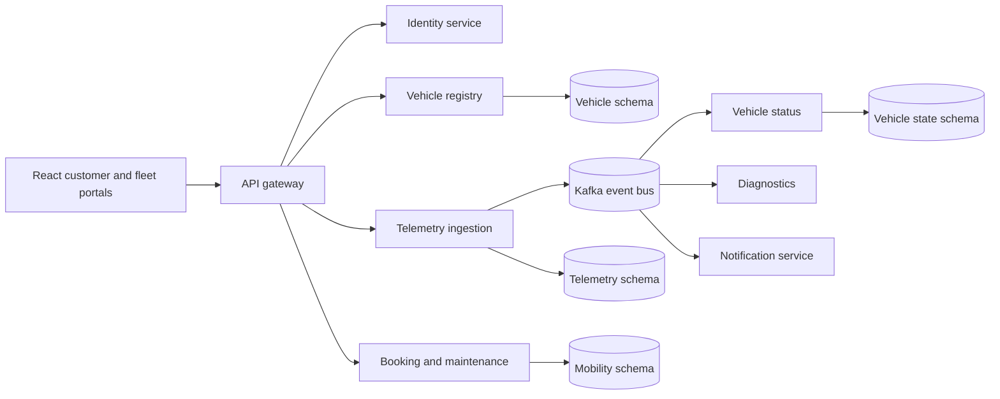

# Architecture

## Initial architecture decision

RoadSphere is a synthetic connected-vehicle learning platform. Keep each business capability in a separately buildable Spring Boot application, but manage the source as a monorepo to make local development and shared conventions practical. A gateway is the only browser-facing API entry point. PostgreSQL is transactional storage; each domain owns its schema and credentials. Kafka carries versioned business events for workflows that do not need a synchronous response. Redis is optional and will be added only for a defined cache with bounded TTL and invalidation behavior.

## Boundaries and safety

- All identities, trips, coordinates, alerts, and payment outcomes are synthetic.
- No real vehicle commands, payment rails, customer data, or cloud resources are used.
- Backend authorization and ownership checks are required; hiding controls in the UI is not authorization.
- Cross-service workflows use events or explicit state transitions, not distributed transactions.
- Kafka delivery is at least once unless a specific component proves otherwise; consumers must be idempotent.

## Local runnable slice

`services/local-demo-api` is a localhost-only Node.js adapter so the fleet portal can exercise synthetic vehicle reads, registration, telemetry, diagnostics, maintenance bookings, and payment simulation while most target Spring Boot services remain planned. The separately packaged `vehicle-registry-service` provides PostgreSQL-backed metadata on port `8083`. Fleet telemetry passes through `telemetry-ingestion-service` on port `8086`, which checks the registry and commits an event to its PostgreSQL outbox before publishing a keyed Kafka record. `vehicle-status-service` on port `8087` consumes the event with bounded retry and dead-letter handling, then stores the latest projection with duplicate receipts. Compose reads status asynchronously; the Node API still computes demo alerts and keeps workflow state in memory. Standalone `scripts/dev.mjs` uses temporary API state unless service URLs are explicitly set. Compose uses schema-scoped logins and ephemeral database/broker storage. These learning implementations have no user authentication and do not claim production readiness.

## ADRs

### ADR-001: modular monorepo with separately packaged services

Status: accepted for the learning environment. Each service will have its own build artifact, configuration, API, Dockerfile, tests, and deployment template. Shared code is limited to stable contracts and conventions. This avoids treating 25 folders around one CRUD application as independent services.

### ADR-002: synthetic-only domain and payment simulation

Status: accepted. Seed data and demo flows are generated for learning. Payment simulation never calls an external payment provider.

### ADR-003: PostgreSQL domain ownership and Kafka workflow events

Status: accepted. Schemas and credentials are scoped to service ownership. Kafka event names and schemas are versioned; outbox, retries, dead-letter handling, idempotency, and retention are required before calling workflows reliable.
